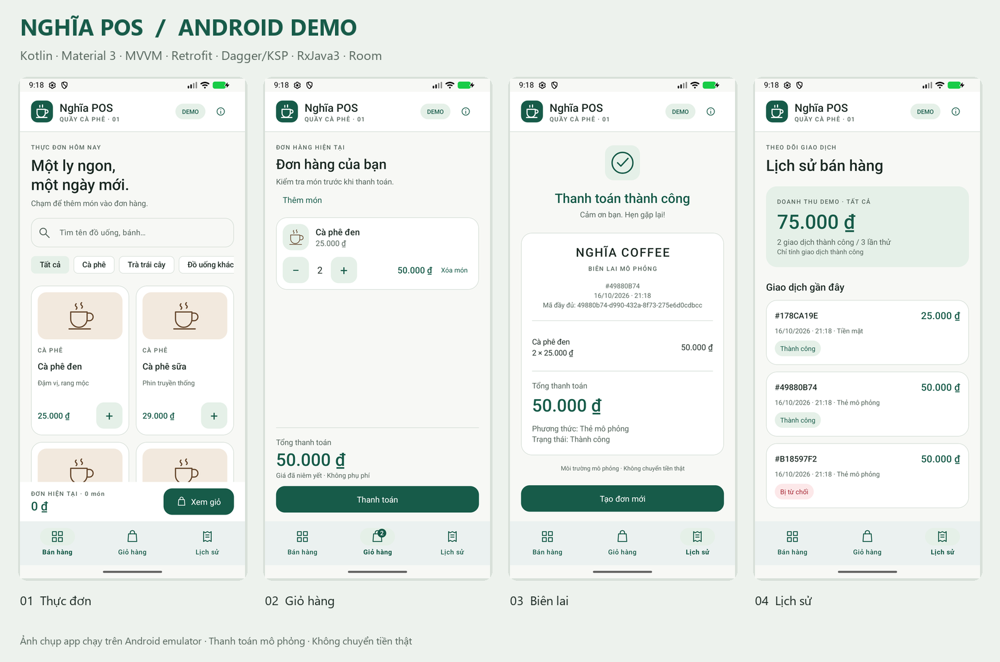

# Nghĩa POS — Android interview demo

Ứng dụng Android native dành cho nhân viên quầy cà phê, xây dựng theo yêu cầu tuyển dụng **Android cho máy thanh toán POS**. Tác giả: **Huỳnh Nguyễn Chí Nghĩa**.

**Kotlin · XML Views · Material 3 · MVVM · Retrofit · Dagger/KSP · RxJava3 · Room**

App không yêu cầu đăng nhập, máy chủ, API key hoặc Internet sau khi cài. Danh mục 12 món đi qua Retrofit và OkHttp interceptor cục bộ. Thanh toán tiền mặt/thẻ đều là **mô phỏng**, không chuyển tiền thật. Không thu thập số thẻ, không kết nối ngân hàng, không gọi SDK thiết bị hoặc máy in.

## Bắt đầu từ bản clone

Clone `https://github.com/nghiahnc/mobile-pos-demo.git`, mở thư mục `mobile-pos-demo` bằng Android Studio, chọn **Trust project**, đợi Gradle Sync, rồi Run `app` trên `Medium_Phone` hoặc thiết bị Android 8+.

Hoặc dùng PowerShell:

```powershell
git clone https://github.com/nghiahnc/mobile-pos-demo.git
cd mobile-pos-demo
.\scripts\build.ps1 -Install
```

Script chạy unit test, Android lint, build APK, cài và mở app trên thiết bị ADB đang kết nối. Có thể chọn thiết bị bằng `-DeviceId emulator-5554`. Nếu chưa có thiết bị, chạy emulator trong Android Studio → Device Manager → Medium_Phone trước khi dùng `-Install`.

APK debug được tạo tại `app/build/outputs/apk/debug/app-debug.apk`; script build còn sao chép vào `artifacts/NghiaPOS-debug.apk`. APK/ZIP và debug keystore không lưu trong Git. Android Studio tạo `local.properties` theo SDK trên máy của bạn.



## Luồng sử dụng

1. **Bán hàng:** tìm không dấu/có dấu, lọc danh mục, thêm đồ uống hoặc bánh.
2. **Giỏ hàng:** tăng/giảm từng món, xóa món, xem tổng VND; số lượng mỗi món từ 1–99.
3. **Thanh toán:** tiền mặt tính tiền thừa; thẻ có ba kịch bản **Thành công / Bị từ chối / Lỗi kết nối**.
4. **Biên lai:** mã giao dịch đầy đủ, giờ thiết bị, chi tiết món, phương thức, tổng tiền và kết quả.
5. **Lịch sử:** xem lại mọi lần thử, mở lại biên lai, cộng doanh thu từ giao dịch thành công.

Giỏ hàng và lịch sử lưu vào Room. Các thay đổi giỏ được xử lý tuần tự. Thanh toán thành công ghi biên lai và xóa giỏ trong cùng một transaction; thất bại giữ giỏ. Cùng một mã lần thanh toán trả lại kết quả cũ, không ghi thêm hoặc xóa giỏ mới.

Giao diện tự theo sáng/tối hệ thống, hỗ trợ xoay màn hình và chữ lớn. Từ **840dp chiều rộng khả dụng**, thực đơn và giỏ hiển thị cạnh nhau. Ở chiều ngang thấp, tiêu đề/trang trí được thu gọn để ưu tiên thao tác.

## Build và kiểm thử

Đã khóa phiên bản dependency trong Gradle, kèm Wrapper **9.3.1**, Android Gradle Plugin **9.1.0**, KSP **2.3.9**. AGP tích hợp Kotlin; không thêm plugin `org.jetbrains.kotlin.android`. Dagger **2.60.1** và Room **2.8.4** sinh mã qua KSP.

- Android SDK 36, Build Tools 36.0.0, minSdk 26, targetSdk 36.
- Gradle chạy bằng JDK tương thích Gradle 9.3.1. Trên máy này dùng JBR 25 của Android Studio; bytecode của app là Java 17.
- Lần build đầu cần Internet để tải dependency; việc chạy app sau cài đặt không cần mạng.
- `local.properties` là cấu hình SDK riêng từng máy, đã đưa vào `.gitignore`.

```powershell
# Nếu dùng JBR mặc định của Android Studio trên Windows
$env:JAVA_HOME = 'C:\Program Files\Android\Android Studio\jbr'
.\gradlew.bat :app:testDebugUnitTest :app:lintDebug :app:assembleDebug

# Chạy thêm integration test và UI test trên emulator đang kết nối
.\gradlew.bat :app:connectedDebugAndroidTest
```

**UI test xóa dữ liệu của riêng Nghĩa POS trước mỗi kịch bản.** Không dùng dữ liệu thật trong ứng dụng demo. Báo cáo nằm trong `app/build/reports/tests/`, `app/build/reports/androidTests/` và `app/build/reports/lint-results-debug.html`. Bằng chứng đã chạy và ảnh màn hình: [artifacts/QA.md](artifacts/QA.md).

Để chạy lại bộ kiểm chứng và lưu ảnh trên emulator:

```powershell
.\scripts\capture-qa.ps1
```

Script chỉ chấp nhận emulator, chạy 12 functional/integration tests rồi kiểm tra các màn hình trên 7 cấu hình. Cỡ chữ, kích thước, sáng/tối, rotation và animation được khôi phục sau khi chạy. Ảnh và log lưu vào `artifacts`. Để đóng gói lại sau khi kiểm chứng: `python scripts/package_demo.py` (cần Pillow và font Segoe UI trên Windows).

## Tài liệu phỏng vấn

- [DEMO_SCRIPT.md](docs/DEMO_SCRIPT.md): kịch bản trình diễn 5 phút, các con số mong đợi.
- [ARCHITECTURE.md](docs/ARCHITECTURE.md): sơ đồ phụ thuộc, dữ liệu và bảo đảm giao dịch.
- [JOB_MATCH.md](docs/JOB_MATCH.md): đối chiếu JD, mã nguồn và câu hỏi phỏng vấn.

## Giới hạn chủ động

Không có thuế, khuyến mãi, đồng bộ nhiều máy, quản lý kho, hoàn tiền hoặc tích hợp shop web. Sản phẩm là dữ liệu đóng gói trong `assets/products.json`; thời gian dùng đồng hồ thiết bị. `CONNECTION_ERROR` nghĩa là giả lập chưa xử lý thanh toán, không mô phỏng trường hợp ngân hàng đã trừ tiền nhưng thiết bị mất phản hồi. Tích hợp thật cần lưu trạng thái chờ, đối soát với bên thanh toán và tuân thủ giao thức SDK tương ứng.

## Tài liệu chính thức tham khảo

[AGP 9.1](https://developer.android.com/build/releases/agp-9-1-0-release-notes) · [Dagger KSP](https://dagger.dev/dev-guide/ksp.html) · [Retrofit](https://square.github.io/retrofit/) · [RxJava](https://github.com/ReactiveX/RxJava) · [Room](https://developer.android.com/training/data-storage/room) · [AndroidX Test](https://developer.android.com/jetpack/androidx/releases/test)

**GitHub:** [nghiahnc/mobile-pos-demo](https://github.com/nghiahnc/mobile-pos-demo). Repo giữ source, Gradle Wrapper/schema, tài liệu và ảnh demo; build output, log thiết bị và cấu hình máy được bỏ qua.
