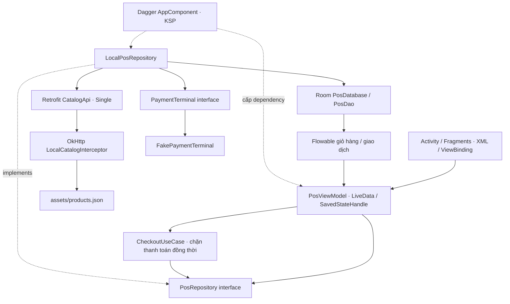

# Kiến trúc Nghĩa POS

Một module Android, ba tầng. Chia tầng vừa đủ để ứng viên giải thích được, không thêm module hoặc framework không phục vụ luồng demo.



## Giao diện

`MainActivity` quản lý điều hướng và system insets. Năm Fragment phụ trách thực đơn, giỏ, thanh toán, biên lai, lịch sử. `PanelCartBinding` dùng chung cho màn giỏ và cột giỏ ở màn hình rộng. Các Fragment không gọi Room hoặc Retrofit trực tiếp.

ViewModel sống theo Activity nên xoay màn hình không tạo thêm phiên thanh toán. `SavedStateHandle` lưu bộ lọc, từ khóa, phương thức, số tiền và kịch bản mô phỏng. FragmentManager khôi phục trang hiện tại; ID biên lai nằm trong arguments. Giỏ và giao dịch là dữ liệu bền vững trong Room, không chỉ là state trong RAM.

## RxJava và vòng đời

- Retrofit trả `Single<List<Product>>`; danh mục được tải ngoài main thread.
- Room trả `Flowable` cho giỏ và lịch sử; UI nhận cập nhật qua `observeOn(mainThread)` và LiveData.
- Mọi lệnh sửa giỏ và thanh toán đi qua `PublishSubject<Completable>` + `concatMapCompletable`. Các lần bấm tăng số lượng nhanh được thực hiện đúng thứ tự, không mất cập nhật.
- `CheckoutUseCase` dùng `AtomicBoolean.compareAndSet` để từ chối subscriber thứ hai khi còn một lần thanh toán đang chạy.
- `CompositeDisposable.clear()` trong `ViewModel.onCleared()`. Observer LiveData gắn `viewLifecycleOwner`, ViewBinding được giải phóng ở `onDestroyView()`.
- Không dùng coroutine hoặc RxJava2 xen kẽ. Bộ giả lập tạo độ trễ 900ms trước transaction để trình bày trạng thái đang xử lý; không ngủ hoặc truy cập DB trên UI thread.

## Hợp đồng dữ liệu tối thiểu

`CatalogApi.products()` gọi `GET https://demo.nghia.invalid/api/products`. OkHttp application interceptor trả JSON từ assets, **không gọi `chain.proceed()`**. Endpoint khác nhận HTTP 404. Manifest không khai báo quyền `INTERNET`, nên cơ chế này không âm thầm gọi mạng.

```json
{"id":"cf01","name":"Cà phê đen","category":"Cà phê","price":25000,"note":"Đậm vị, rang mộc"}
```

Giá, tổng, tiền khách đưa, tiền thừa là `Long` VND. Số lượng là `Int` 1–99; thêm 1 hoặc giảm 1, về 0 thì xóa dòng. `MoneyRules` kiểm tra đầu vào và dùng `Math.multiplyExact/addExact`, không để tràn số thành giá trị âm.

Room gồm:

| Bảng | Khóa | Nội dung |
| --- | --- | --- |
| `cart` | `productId` | Snapshot thông tin sản phẩm và số lượng |
| `receipts` | `id` (UUID của lần thanh toán) | Thời gian, snapshot các dòng JSON, tổng, phương thức, trạng thái, tiền khách đưa, tiền thừa |

Snapshot giúp biên lai vẫn đúng nếu giá hoặc tên trong thực đơn thay đổi. Schema phiên bản 1 được xuất vào `app/schemas`; thay đổi schema sau này cần migration và test, không dùng destructive migration.

## Thanh toán và tính nguyên tử

1. UI kiểm tra giỏ, tiền mặt và chặn thao tác trong lúc xử lý.
2. Mỗi lần thử có UUID. Repository mở transaction Room, tìm UUID trước: nếu đã có thì trả đúng biên lai cũ.
3. Đọc snapshot giỏ từ DB, kiểm tra nghiệp vụ lần nữa, gọi terminal **giả lập cục bộ, không I/O**.
4. Lưu biên lai. Thành công mới xóa giỏ. Hai thao tác cùng commit hoặc cùng rollback.
5. LiveData nhận dữ liệu Room; thành công mở biên lai, thất bại hiển thị lý do và cho thử lại bằng UUID mới.

Nếu process dừng trước commit, giỏ còn và không có thanh toán thật nào xảy ra. Nếu dừng sau commit, biên lai đã lưu và giỏ đã xóa. Replay cùng UUID không xóa giỏ của đơn tiếp theo. Doanh thu luôn lọc `PaymentStatus.SUCCESS`.

Đây không phải cơ chế bảo đảm thanh toán ngân hàng đúng một lần. Terminal thật không nên giữ network I/O trong transaction DB; cần lưu attempt trước khi gọi SDK, khôi phục/đối soát kết quả chưa rõ, và dùng idempotency của nhà cung cấp. Có thể thay `PaymentTerminal` và `PosRepository` mà giữ nguyên phần lớn giao diện/nghiệp vụ.

## Quyết định về giao diện

Material 3 sáng/tối với màu xanh lá, nền dịu, vector cup/tea/cake được vẽ trong resource Android; không dùng ảnh mạng hoặc emoji. Hệ font sans hệ thống hỗ trợ tiếng Việt. Search hỗ trợ không dấu, nút Android có vùng chạm tối thiểu 48dp. Chữ và trạng thái có nhãn, không chỉ phân biệt bằng màu. Không có animation tùy biến bắt buộc; tắt animation hệ thống vẫn sử dụng bình thường.

Breakpoint hai cột nghiệp vụ là chiều rộng 840dp, không gắn cứng vào model máy. Chế độ landscape thu gọn phần tiêu đề/trang trí. Checkout và receipt dùng vùng cuộn, CTA thanh toán có vùng riêng không đè lên nội dung; Activity xử lý bàn phím và thanh điều hướng hệ thống.
